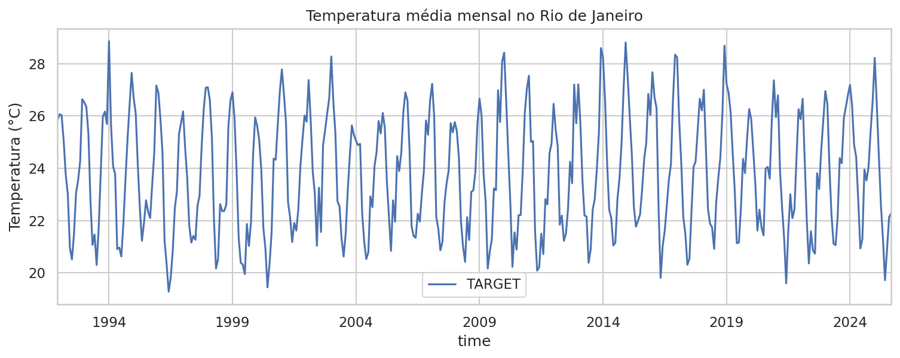
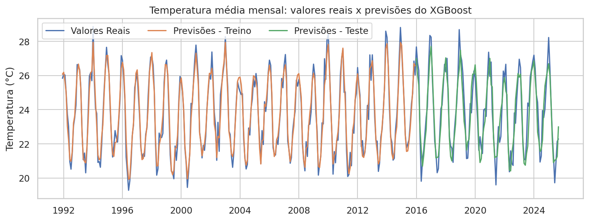
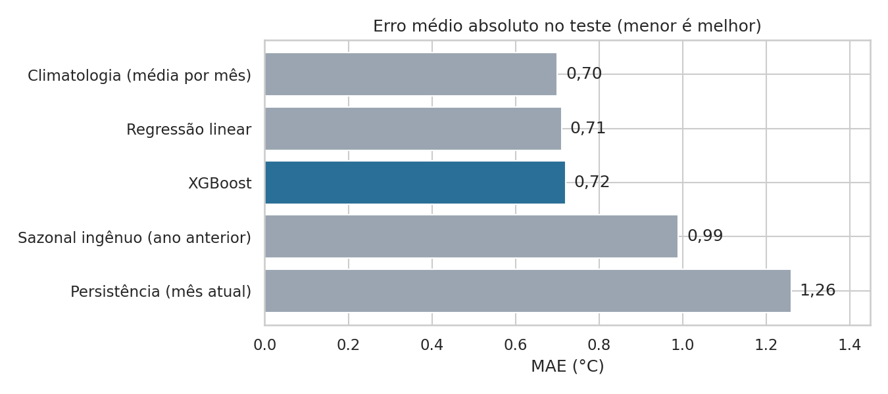
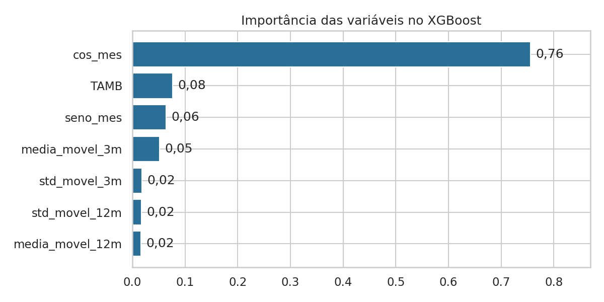
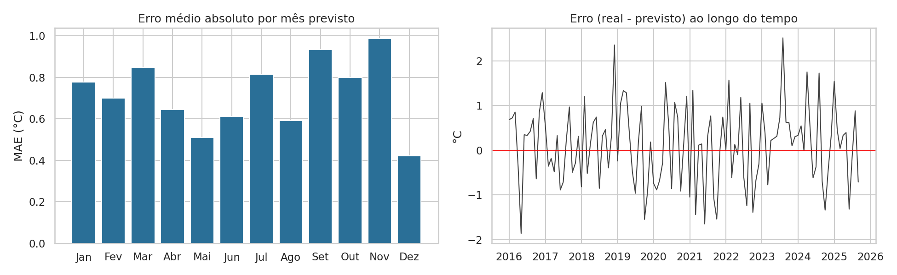

# Previsão da temperatura média mensal no Rio de Janeiro com XGBoost

Projeto de **machine learning para séries temporais**: prever a temperatura média do **mês seguinte** no Rio de Janeiro a partir de informações do mês atual, e avaliar se o modelo realmente supera referências simples.

**Ferramentas:** Python · pandas · scikit-learn · XGBoost · matplotlib · seaborn · Jupyter

> **Origem dos dados e crédito:** projeto prático desenvolvido a partir do vídeo "Como Criar um Modelo de Previsão com Machine Learning (Do Zero)", do canal Eficiência Programada.

---

## Pergunta

É possível prever a temperatura média do próximo mês no Rio de Janeiro, e quão melhor é um modelo de machine learning do que referências simples?

## Os dados

- **406 meses**, de dezembro de 1991 a setembro de 2025, sem valores nulos
- **Variável prevista (`TARGET`):** temperatura média do mês seguinte (°C)
- **Variáveis de entrada:** temperatura do mês atual (`TAMB`), mês do ano codificado com seno e cosseno (`seno_mes`, `cos_mes`), médias móveis de 3 e 12 meses e desvios padrão móveis de 3 e 12 meses
- As janelas móveis usam apenas dados até o mês atual, então não há vazamento de informação do futuro



## Método

1. **Divisão temporal:** treino de 1991 a 2015 (71%) e teste de 2016 a 2025 (29%), respeitando a ordem do tempo
2. **Modelo:** `XGBRegressor` com 100 árvores, profundidade 3 e taxa de aprendizado 0,1
3. **Métricas:** R², erro médio absoluto (MAE, em °C), RMSE e MAPE
4. **Referências (baselines):** persistência, sazonal ingênuo (mesmo mês do ano anterior), climatologia (média histórica de cada mês) e regressão linear
5. **Validação cruzada temporal** com 5 janelas de 60 meses



## Resultados

| Modelo | R² | MAE (°C) | RMSE (°C) | MAPE (%) |
|---|---|---|---|---|
| Climatologia (média por mês) | 0,84 | 0,70 | 0,90 | 2,92 |
| Regressão linear | 0,85 | 0,71 | 0,86 | 2,98 |
| **XGBoost** | **0,85** | **0,72** | **0,88** | **3,03** |
| Sazonal ingênuo (ano anterior) | 0,70 | 0,99 | 1,24 | 4,17 |
| Persistência (mês atual) | 0,57 | 1,26 | 1,47 | 5,31 |

> Valores obtidos no conjunto de teste (2016 a 2025). Podem variar na segunda casa decimal conforme a versão do XGBoost.



**O que descobri**

- O XGBoost prevê a temperatura do mês seguinte com **erro médio de cerca de 0,7 °C**.
- Ele é **bem melhor** que repetir o mês atual ou o mesmo mês do ano anterior.
- Mas fica **praticamente empatado com a simples média histórica de cada mês** e com uma regressão linear. Quase tudo o que o modelo aprendeu é o padrão sazonal: a variável `cos_mes` concentra a maior parte da importância.
- Há sinal de sobreajuste moderado: R² de ~0,96 no treino contra ~0,85 no teste.
- A validação cruzada temporal mostra desempenho consistente entre as janelas (R² entre 0,74 e 0,87).





## Limitações

- As variáveis usam só a própria temperatura passada; fatores como umidade, pressão e El Niño não foram incluídos.
- O horizonte é de apenas 1 mês.
- Os hiperparâmetros foram fixados, sem busca por valores melhores.
- Diferenças de poucos centésimos entre modelos não são estatisticamente conclusivas.

## Próximos passos

- Incluir variáveis externas (umidade, pressão, índices climáticos) e testar se superam a climatologia
- Testar horizontes de 3 e 6 meses e outros modelos (SARIMA, Prophet)
- Ajustar hiperparâmetros com validação cruzada temporal
- Gerar a previsão dos próximos meses com intervalo de confiança

## Como reproduzir

```bash
git clone https://github.com/GabrielMarteloti/previsao-temperatura-rj.git
cd previsao-temperatura-rj
pip install -r requirements.txt
jupyter notebook previsao_temperatura_rj.ipynb
```

## Estrutura

```
├── previsao_temperatura_rj.ipynb          # notebook completo, com saídas
├── dados/
│   └── dados_preprocessados_temp_rj.csv
├── images/                                # gráficos gerados pelo notebook
└── requirements.txt
```

## Crédito

Projeto prático baseado no vídeo "Como Criar um Modelo de Previsão com Machine Learning (Do Zero)" do canal **Eficiência Programada**. Análises adicionais: comparação com referências simples, importância das variáveis, análise de erros e validação cruzada temporal.

## Autor

**Gabriel Marteloti** · [LinkedIn](https://www.linkedin.com/in/gabriel-marteloti-815750329/)
